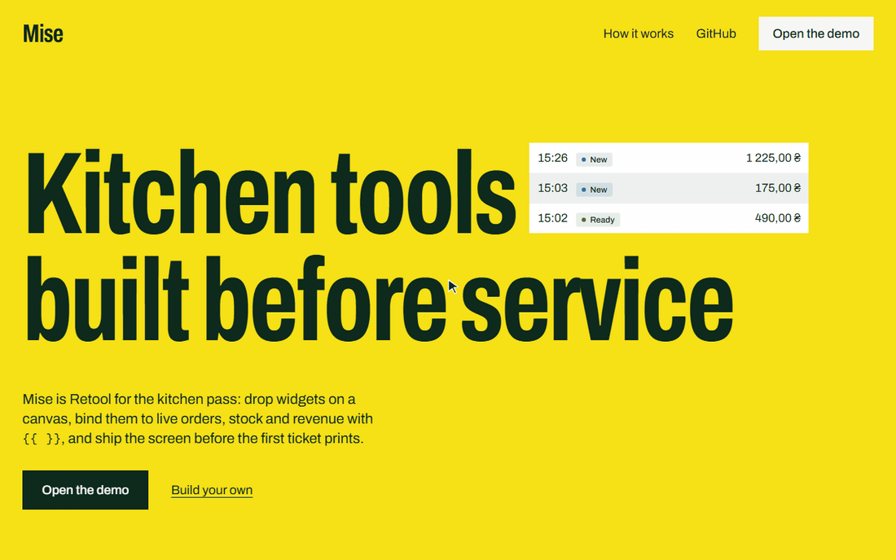
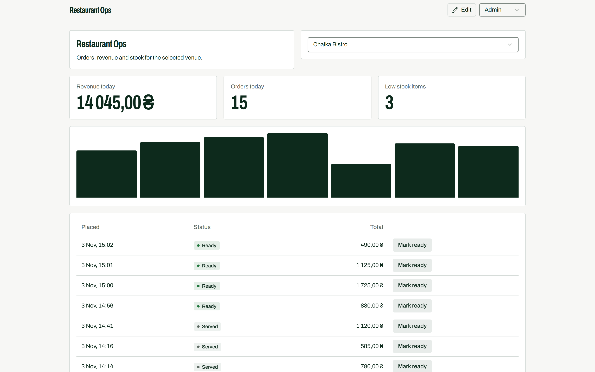
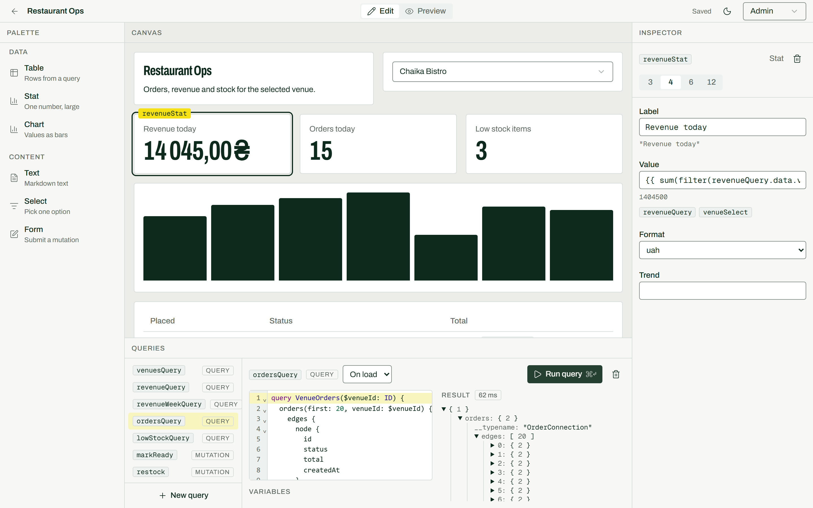
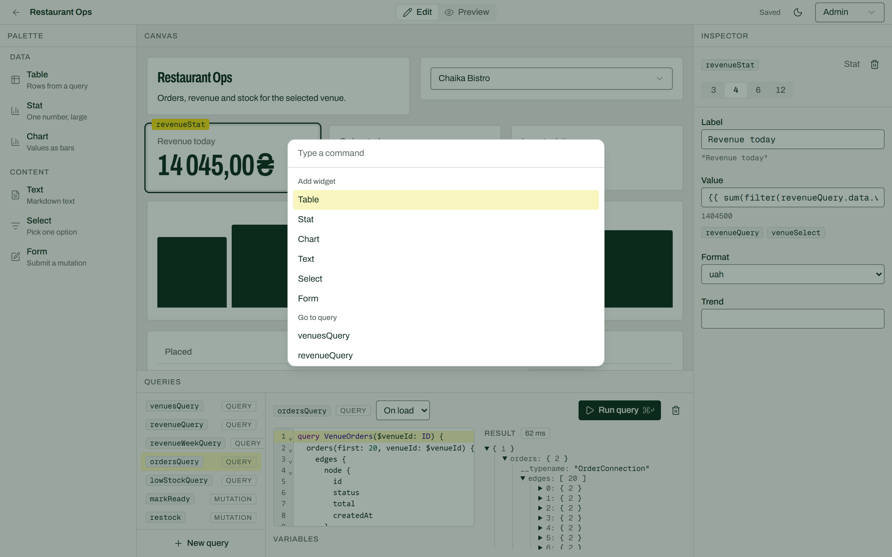
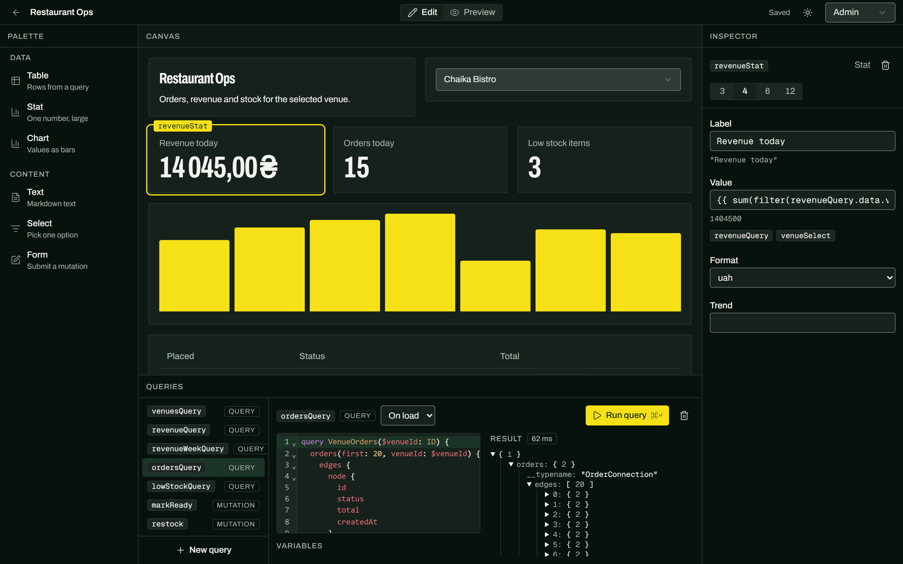
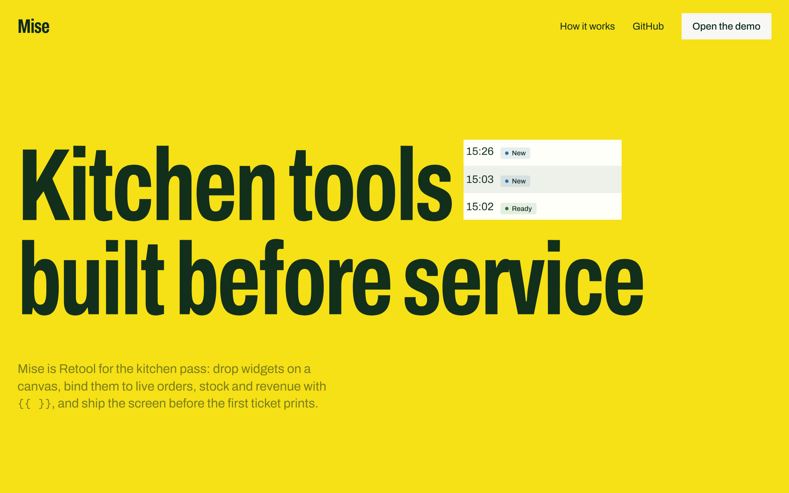
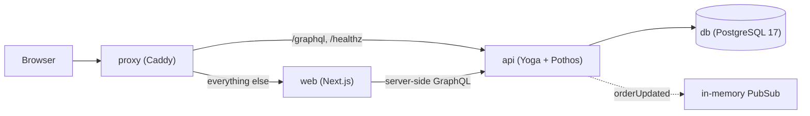

<div align="center">

# Mise

**Kitchen tools built before service.**

A low-code builder for restaurant internal tools: drop widgets on a grid, write GraphQL queries against live orders, stock and revenue, and bind them together with `{{ }}` expressions.

[](https://github.com/kotlovyim-dev/miseboard/actions/workflows/ci.yml)
[](LICENSE)
[](https://mise.kaymos.site)

[**Open the live demo**](https://mise.kaymos.site) · [Architecture](#architecture) · [Decisions](docs/adr) · [Run it locally](#local-setup)



</div>

## What it does

### Run an app on live data



An app is a 12-column grid of widgets: Table, Stat, Chart, Text, Select and Form. Picking a venue re-runs only the queries that depend on it, and the stats, chart and orders table follow. Row actions run mutations with an optimistic update and a 5-second Undo toast. Queries that read orders stay live through the `orderUpdated` subscription and fall back to polling every 5 seconds.

### Build it in the editor



- **Palette, canvas, inspector.** Drag widgets onto the grid, reorder them, set widths of 3, 4, 6 or 12 columns.
- **Bindings.** Any property can be a `{{ }}` expression. The inspector shows the evaluated value under the field and the widgets and queries it references; referenced widgets are marked on the canvas.
- **Queries and mutations.** A CodeMirror editor validates GraphQL against the live schema, runs it and shows the result as a JSON tree with timing. Variables can be expressions too, and an optional transformer reshapes the result in a worker with a 1-second timeout.
- **Forms from mutations.** A Form widget derives its fields from the chosen mutation's variables.
- **Autosave with conflict detection.** Edits save 800 ms after the last change; a stale save offers Reload or Overwrite.
- **Edit and Preview** switch in place, so the app can be tried without leaving the editor.

### Work from the keyboard, in either theme

| Command palette (<kbd>Ctrl</kbd>/<kbd>Cmd</kbd> + <kbd>K</kbd>)                                     | Dark mode                                                                                  |
| --------------------------------------------------------------------------------------------------- | ------------------------------------------------------------------------------------------ |
|  |  |

Undo and redo (<kbd>Ctrl</kbd>/<kbd>Cmd</kbd> + <kbd>Z</kbd>, <kbd>Shift</kbd> + <kbd>Ctrl</kbd>/<kbd>Cmd</kbd> + <kbd>Z</kbd>), duplicate (<kbd>Ctrl</kbd>/<kbd>Cmd</kbd> + <kbd>D</kbd>) and a shortcut help dialog cover the rest. The theme follows the system until it is toggled.

### Start from the landing page



The landing page puts the real demo data in its headline, and its showcase input evaluates a `{{ }}` expression with the same engine the apps use, as you type. It renders from a static snapshot when the API is down.

## Try it

The demo opens as **Admin**, so an app can be built right away: create an app, add a Table, add a query such as `orders(first: 20) { edges { node { id status total } } }`, and bind the table to `{{ ordersQuery.data.orders.edges }}`.

The role switcher in the header changes the demo role without a login. The role lives in a signed HTTP-only cookie and the API enforces it, not only the UI:

| Role    | Can do                                                                            |
| ------- | --------------------------------------------------------------------------------- |
| Admin   | Create, edit and delete apps, run any query, run mutations, reset the demo data   |
| Manager | Use apps in Preview, run mutations from widgets (order status, stock, menu items) |
| Viewer  | Use apps in Preview, read-only                                                    |

This is a demo mechanism, not authentication: anyone can switch to any role.

The data is fictional: three venues, a 40-item menu, about 1,500 orders over the last 30 days and about 60 inventory items. The "Restaurant Ops" template is read-only; creating an app from it copies the config.

## Architecture



The stack runs from one `docker-compose.yml` behind a single domain, so the browser makes no cross-origin requests. Only the proxy publishes ports (80 and 443); it also rate-limits `/graphql` to 30 requests per second per IP.

Workspace layout (pnpm):

| Path              | Role                                                                      |
| ----------------- | ------------------------------------------------------------------------- |
| `apps/web`        | Next.js App Router: editor, runtime, widgets                              |
| `apps/api`        | GraphQL Yoga server, Pothos schema, repositories, WebSocket subscriptions |
| `packages/engine` | Expression parser, interpreter, dependency graph. No React, no DOM        |
| `packages/config` | Zod `AppConfig` schema shared by web and api                              |
| `packages/db`     | Drizzle schema, migrations, seed and demo reset                           |
| `packages/schema` | Printed SDL and generated typed GraphQL documents                         |

How an app runs: the config is validated by `packages/config`. Every templated property and query variable goes into `packages/engine`, which builds a dependency graph (widgets and queries are the nodes), reports cycles and unknown identifiers, and re-evaluates only the downstream nodes of whatever changed. The web runtime renders widgets from the evaluated props and runs queries through Apollo Client.

## Key decisions

Each decision has a short record in [docs/adr](docs/adr).

- **Code-first schema with Pothos.** Types and resolvers share one TypeScript source; the SDL is printed to `packages/schema/schema.graphql` and CI fails if the generated files are stale. [0001](docs/adr/0001-code-first-schema-with-pothos.md)
- **Own expression interpreter, no `eval`.** Expressions are parsed with `jsep` and walked by a whitelist interpreter with step and size limits. [0002](docs/adr/0002-own-expression-interpreter.md)
- **Keyset pagination.** Order cursors encode `createdAt` and `id`, so pages stay stable when orders are inserted. [0003](docs/adr/0003-keyset-pagination.md)
- **App config as one JSON document.** An app is one `jsonb` value validated by the same Zod schema on both sides. [0004](docs/adr/0004-config-as-one-json-document.md)
- **Single-instance PubSub.** Subscriptions use an in-memory PubSub, which fixes the API at one instance. [0005](docs/adr/0005-single-instance-pubsub.md)

Smaller choices:

- Money is an integer in kopecks end to end; the `formatUAH` helper formats it.
- `Order.venue`, order items and menu items load through DataLoader. A test asserts that a page of orders with venue, items and menu items costs at most four SQL queries.
- RBAC uses Pothos scope auth and returns a `FORBIDDEN` error. A stale save returns a typed `VersionConflict` result instead of an error.
- A mutation run from a widget updates the Apollo cache optimistically and shows a 5-second Undo toast that sends an inverse mutation.
- Autosave runs 800 ms after the last edit and sends `expectedUpdatedAt`; a conflict offers Reload or Overwrite.
- The API caps user-written queries at depth 6, 1,000 tokens and 20 aliases, and aborts execution after 5 seconds. Introspection stays on because the query editor validates against the schema. GraphQL requests need the `x-miseboard-csrf` header, which the client always sends.
- The Text widget renders Markdown with raw HTML skipped. ESLint bans `eval`, `new Function` and `dangerouslySetInnerHTML`.

## Deliberate non-goals

- A general-purpose Retool replacement.
- Real authentication, sign-up, multi-tenancy, billing.
- A free-form canvas (resize handles, snapping, nested containers). The canvas is a 12-column grid with widths 3, 4, 6 and 12, reordered by drag and drop.
- Real-time collaboration (shared cursors, CRDTs).
- Arbitrary external data sources or a runtime-generated server schema. Queries run against this API only.
- Multi-page apps and routing between app pages.
- A mobile editor. Preview is responsive; the editor expects a desktop screen (1280 px and wider).
- AI features.

## Known limitations

- The role switcher is not security. The cookie is signed, but any visitor can pick Admin.
- The API must run as a single instance: PubSub is in memory, so `orderUpdated` events are not shared between processes. Several instances need a shared broker, for example Postgres `LISTEN/NOTIFY` or Redis.
- Order pagination is forward-only (`first` and `after`); `hasPreviousPage` is always `false`. Backward paging needs `last` and `before`.
- Tables page in the browser over the rows the bound query returned. Large datasets need a query that pages on the server.
- Expressions are limited to 10,000 evaluation steps and arrays to 10,000 items.
- Introspection is on so the editor can validate queries, which also exposes the schema to every visitor.
- The API re-applies the template config on every boot, so manual edits to the template row are overwritten.
- The end-to-end suite is a single smoke test; most coverage lives in the Vitest suites.

## Operations

- The API runs Drizzle migrations at startup and seeds when the `venues` table is empty, so a fresh deployment needs no manual steps.
- `GET /healthz` returns 200 when the API can reach the database and 503 otherwise.
- The demo data can be reset with the Admin-only `resetDemo` mutation. It re-runs the seed so order dates are relative to the reset time, keeps the template and deletes user apps older than 7 days. Admins can run it from the "Reset demo" button on `/apps`, and a cron job runs it every night at 02:30.
- The live demo runs on [Kayly](https://github.com/kotlovyim-dev/kayly) from `kayly.toml`: one image with the proxy, web, api and reset services and a managed PostgreSQL. A push to `main` deploys.

## Testing

Vitest in every package. CI (`.github/workflows/ci.yml`) runs on each push and pull request: install, lint, typecheck, tests against a PostgreSQL 17 service container, and a check that the generated GraphQL files are up to date. A separate job runs the Playwright smoke test against the API and web dev servers.

- `packages/engine`: parsing and rejection of forbidden constructs, type preservation for single-block templates, dependency extraction, cycles, diamond dependencies, downstream-only re-evaluation, step and array limits, blocked `__proto__` access. A benchmark test asserts that one update across forty widgets takes under 16 ms.
- `packages/config`, `packages/db`: config validation, seed and reset against a real database.
- `apps/api`: resolvers and RBAC against a real database, including the SQL query count for a page of orders.
- `apps/web`: runtime, query runner, transformer worker, mutation planning and autosave logic.
- `e2e`: Playwright opens the Restaurant Ops app, marks an order ready and expects the Undo toast.

## Local setup

Requirements: Node 24, pnpm 12.16.1 (via Corepack), Docker.

```sh
pnpm install
cp .env.example .env
docker compose -f docker-compose.dev.yml up -d db
pnpm dev
```

- The dev database service also creates a `miseboard_test` database used by the tests.
- The API listens on `http://localhost:4000`, applies migrations and seeds on first start. The web app runs on `http://localhost:3000` and proxies `/graphql` to the API in development.
- `COOKIE_SECURE=false` in `.env.example` lets the role cookie work over plain HTTP locally.

| Command                                               | Does                                               |
| ----------------------------------------------------- | -------------------------------------------------- |
| `pnpm dev`                                            | API and web in watch mode                          |
| `pnpm codegen`                                        | Prints the SDL and regenerates the typed documents |
| `pnpm check`                                          | Lint, typecheck, tests and the codegen check       |
| `pnpm e2e`                                            | Playwright smoke test                              |
| `pnpm db:generate`, `pnpm db:migrate`, `pnpm db:seed` | Drizzle migrations and seed                        |

Production uses `docker-compose.yml`, which requires `SITE_ADDRESS`, `POSTGRES_PASSWORD` and `COOKIE_SECRET` in the environment. Secrets stay out of the repository.

## License

MIT
